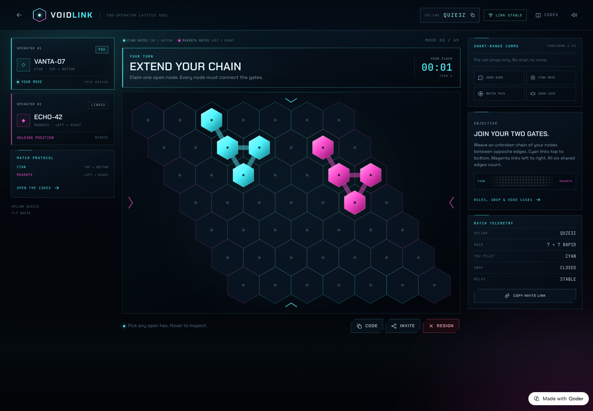
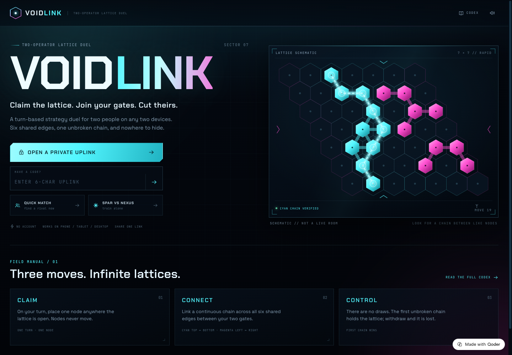
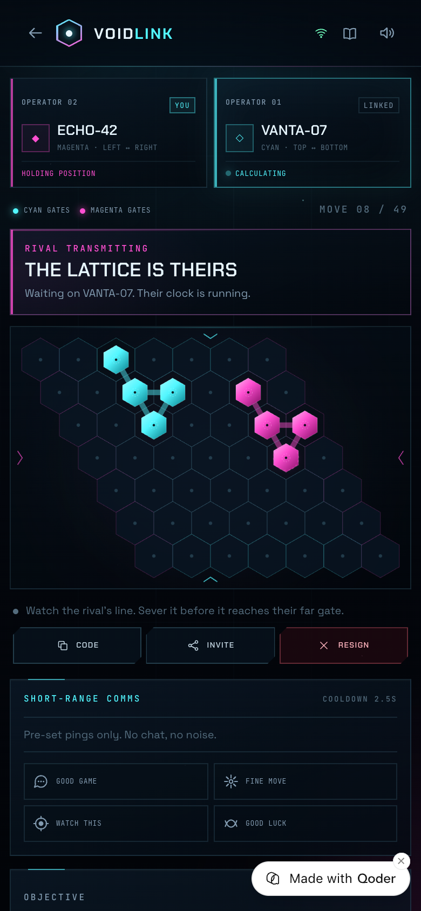
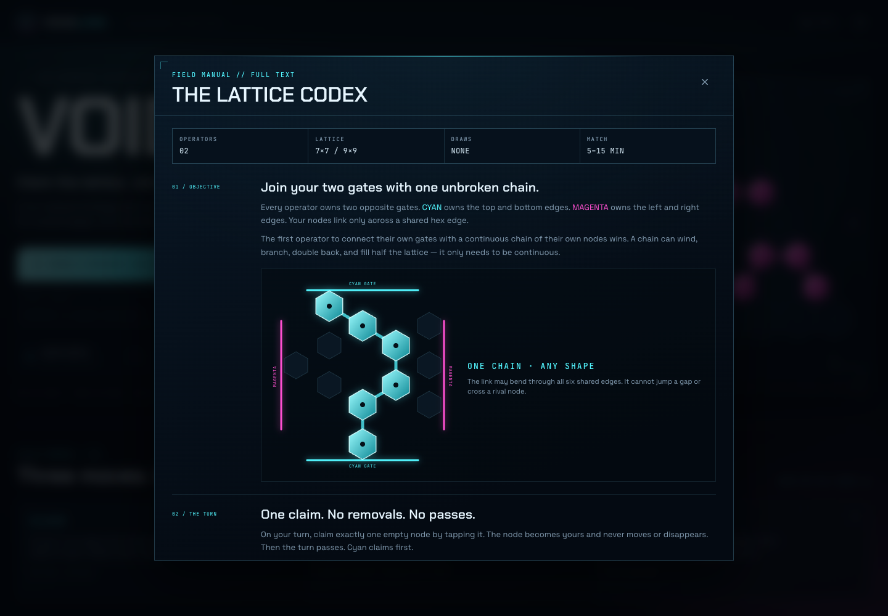
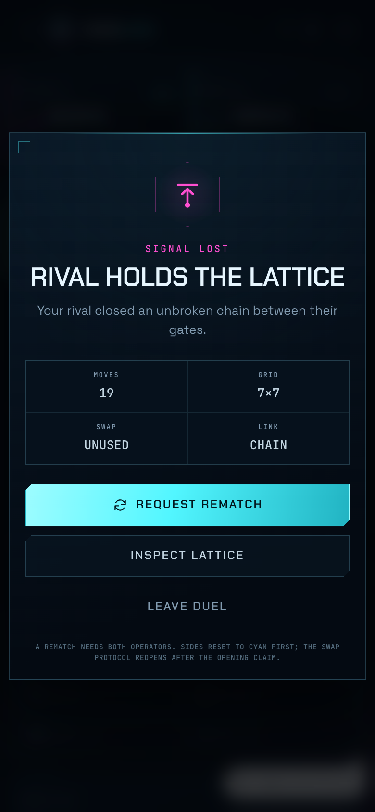

# VOIDLINK

**Two operators. One lattice. Link your gates. Cut theirs.**

VOIDLINK is a live, turn-based board duel for two people on separate devices. Claim nodes on a
hex lattice, build an unbroken chain between your gates, and sever your rival's line before it
closes.

[**Play the live game →**](https://voidlink-khsmca9k4iv.qoder.website) ·
[Rules](#rules) · [Architecture](#architecture) · [Run it locally](#run-it-locally)



| The deck | On a phone |
| --- | --- |
|  |  |

| The Codex | A sealed lattice |
| --- | --- |
|  |  |

## What you can do

- Open a private uplink, send one six-character code or one link, and play from any two devices.
- Quick-match into a public lattice, or train against NEXUS, a local sparring AI with three grades.
- Choose a **7×7 rapid** lattice for a sharp 5–10 minute duel, or a **9×9 classic** for a longer campaign.
- Reconnect after a refresh, swap gates to cancel the first-move advantage, request a rematch,
  send one of four pre-set pings, or spectate a full room.
- Play with a keyboard as well as touch or a mouse. The layout runs from a 320 px phone to a wide monitor.

No account. No install. No chat.

> The underlying connection game is **Hex**, a public-domain rule set. VOIDLINK is an original
> product around it: a live room system, a two-gate visual language, a fairness protocol, a
> responsive mission-control interface, and an offline sparring opponent.

## Rules

1. **Claim one node.** On your turn, tap or click any empty hex. Nodes never move or disappear.
2. **Link your gates.** CYAN owns the top and bottom edges; MAGENTA owns the left and right edges.
   Adjacent nodes connect across their shared edge.
3. **First chain wins.** The first operator with an unbroken chain of their own nodes joining
   their two gates holds the lattice.
4. **No draws.** A sealed lattice always links exactly one side.
5. **Swap protocol.** After cyan's opening claim only, magenta may swap once: take the opening
   node and the cyan gates, exchanging sides. This is the fairness rule that cancels the known
   first-player advantage.
6. **A duel can also end** by withdrawal, or by claiming a disconnect after a rival has been
   silent for 80 seconds. Rematches need both operators.

The in-app **Codex** carries the full rules, controls, swap details, and disconnect policy.

## Live verification

The deployed game was exercised end to end from two independent browser contexts on the public
URL:

- create → join across desktop and mobile
- a complete 19-move chain win
- rematch request → accept, and the swap protocol
- reload → original seat and board restored
- quick-match pairing into the same public room
- a third context spectating the live board
- short-range pings, withdrawal, and the final result state
- leaving an unfilled lobby deletes it instead of leaving a ghost room behind

`npm test` covers the rules, AI, HTTP contract, token boundaries, version compare-and-set,
rematch flow, disconnect forfeit, quick matching, lobby cancellation and simultaneous-move
serialisation — **38 tests**.

## Architecture

```text
Browser A ─┐
           ├── same-origin /functions/v1/app ── room service ── Postgres (rooms + seats)
Browser B ─┘
```

- **Client:** React 19 + TypeScript + Vite. The lattice is a single responsive SVG with
  keyboard navigation and accessible cell labels. No image assets are needed for gameplay.
- **Rules engine:** pure TypeScript in `shared/engine.ts`; win paths, axial adjacency,
  no-draw property and route costs are unit-tested. The sparring AI uses weighted shortest-route
  evaluation, bridge detection and immediate-threat blocking.
- **Relay:** `shared/service.ts` owns every game rule on the server. `shared/api.ts` is a
  transport-agnostic Request/Response handler. The local Node relay and the deployed Edge
  Function both use these exact files; `npm run sync:function` copies them into
  `functions/app/`, and `npm run check` fails if the copies drift.
- **Multiplayer:** six-character, ambiguity-free room codes. Each seat gets a 256-bit bearer
  token; only its SHA-256 hash is stored. Moves and room transitions are server-authoritative,
  with a versioned compare-and-set on the room row and primary-key seat uniqueness. The client
  polls every ~1.4 seconds, sends heartbeats, and applies action responses immediately.
- **Persistence:** two Postgres tables, `rooms` and `seats` (`db/schema.sql`). No accounts and no
  business rows beyond a display callsign and room state. The platform injects the database
  client; `functions/app/supabase-store.ts` is the only adapter that knows about it.

## Run it locally

Requires Node 20.19+ (or 22.12+).

```bash
npm install
npm run dev
```

- Web client: `http://127.0.0.1:5173`
- Local relay: `http://127.0.0.1:8787` (in-memory, started with the same room rules)
- Open two windows or two incognito profiles to play locally. The local relay resets when it
  restarts; the deployed game uses Postgres.

Useful commands:

```bash
npm test                 # engine, AI and room/HTTP tests
npm run build            # typecheck + production client build
npm run check            # function-sync check + tests + build
npm run sync:function    # copy shared relay modules into functions/app
```

## Deployment

The public instance runs as a **Qoder Site**: a static Vite build plus one Edge Function and a
managed Postgres database. `prepare_site` was used with:

- `webDirectory: dist`
- `functionDirectory: functions/app`
- `databaseAccess: read_write`
- the schema revision from `db/schema.sql`

The platform provides `functions/app/_qoder/backend.mjs` at runtime; it is intentionally not in
this repository. To host elsewhere, keep the client and `shared/` code, supply a database adapter
with the same `RoomStore` contract as `functions/app/supabase-store.ts`, and serve the API at
`/functions/v1/app/api/*` from the same origin (or update `API_BASE` in `shared/protocol.ts`).
The game does not rely on a specific cloud beyond that adapter.

## Project map

```text
shared/                 pure rules, room service and HTTP contract
  engine.ts             hex rules, win path, route cost, AI support
  ai.ts                 NEXUS sparring opponent
  service.ts            authoritative rooms, seats, moves, swap, rematch, forfeit
  api.ts                Request/Response routing and validation
src/                    React client
  components/Board.tsx  interactive SVG lattice
  components/Game.tsx   live match UI, result, comms, disconnect claim
  components/Codex.tsx  full rules and controls
functions/app/          deployable Edge Function (server files synced from shared/)
server/                 local Node relay + in-memory store
db/schema.sql           Postgres schema used by the live deployment
tests/                  38 Vitest tests
docs/screenshots/       screens from the game
```

## Design and access

The interface uses a dark, high-contrast mission-control language: cyan and magenta are never
the only distinction — every side is labelled with its name and gate direction. Gameplay has an
`aria-live` status, labelled dialogs and buttons, and a keyboard path over the board: tab in,
arrow between nodes, Enter or Space to claim. Motion is disabled under
`prefers-reduced-motion`. The smallest layouts stack player telemetry, then the board, then
comms; 9×9 on a very small screen is dense by nature and benefits from browser zoom.

**Privacy:** no accounts, no analytics, no open chat. Room codes are the invitation. Seat tokens
are kept in this browser's local storage; clearing site data turns that device into a spectator.
Display callsigns are sanitised before they are stored or shown.

## Credits

Built by [Soumwadeep Guha](https://github.com/soumwadeep). Rules ancestry: the public-domain game
Hex. Typefaces: Space Grotesk, Chakra Petch and JetBrains Mono (SIL Open Font License).

## License

[MIT](LICENSE)
